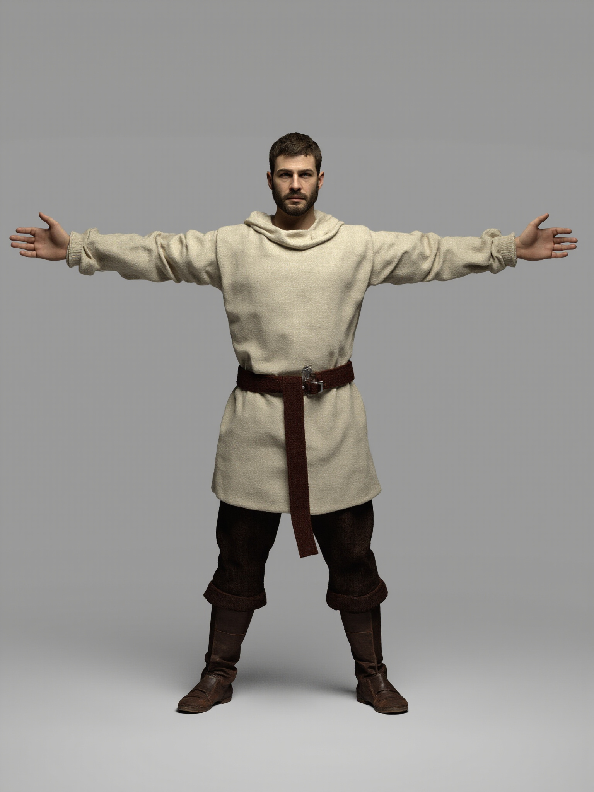
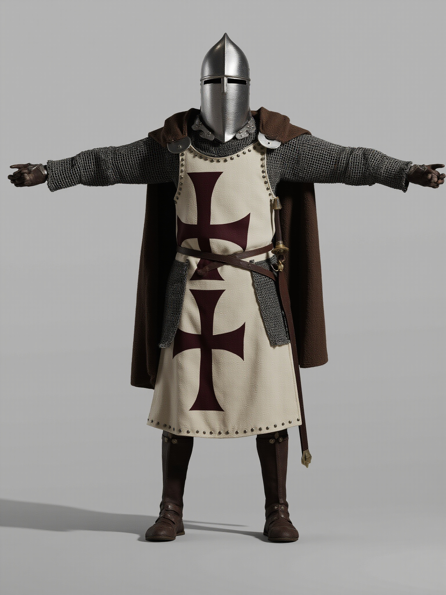

# 圣殿骑士 · 2D 高清效果图

> 2D 视觉资产（非 3D 模型）｜MiniMax image-01｜2026-10-26
> 生成脚本：`tools/gen_effect_2d.py`｜拼版：`tools/make_effect_sheets.py`

## T-pose 对照

  
  

| 文件 | 内容 | 分辨率 | seed |
| --- | --- | --- | --- |
| [01_templar_tpose_unarmored.png](final/01_templar_tpose_unarmored.png) | 无甲：亚麻内袍 / 布腰带 / 羊毛裤 / 皮靴，面部可见 | 1536×2048 | 454 |
| [02_templar_tpose_armored.png](final/02_templar_tpose_armored.png) | 有甲：桶盔 / 锁子甲 / 红十字罩袍 / 披风 / 佩剑 | 1536×2048 | 504 |
| [03_templar_full_kit.png](final/03_templar_full_kit.png) | 全套装备英雄图：加鸢形盾，3/4 站姿 | 1536×2048 | 902 |

拼版：[templar_tpose_compare.png](templar_tpose_compare.png)（2360×1980）

## 装备素材（9 件）

拼版：[templar_gear_sheet.png](templar_gear_sheet.png)（2520×3200）

| # | 文件 | 装备 | 分辨率 |
| --- | --- | --- | --- |
| 01 | [great_helm](gear/01_great_helm.jpg) | 大桶盔（尖顶 sugarloaf 变体） | 1536×1536 |
| 02 | [kite_shield](gear/02_kite_shield.jpg) | 鸢形盾（白底红十字） | 1536×1536 |
| 03 | [arming_sword](gear/03_arming_sword.jpg) | 佩剑 + 皮剑鞘 | 1536×1536 |
| 04 | [mail_hauberk](gear/04_mail_hauberk.jpg) | 锁子甲长袍 | 1536×1536 |
| 05 | [leather_boots](gear/05_leather_boots.jpg) | 及膝皮靴 | 1536×1536 |
| 06 | [leather_belt](gear/06_leather_belt.jpg) | 皮腰带 + 黄铜带扣 | 1536×1536 |
| 07 | [wool_cloak](gear/07_wool_cloak.jpg) | 深棕羊毛披风 | 1536×1536 |
| 08 | [leather_gloves](gear/08_leather_gloves.jpg) | 皮手套一对 | 1536×1536 |
| 09 | [surcoat](gear/09_surcoat.jpg) | 十字罩袍 | 1536×1536 |

## 目录

- `final/`：3 张角色正式图（PNG + 同名 JSON 元数据）
- `gear/`：9 张装备正式图（JPG + 同名 JSON 元数据）
- `drafts/`：全部候选图（seed 命名，可回溯）
- `manifest.json`：成图与 seed 索引

流程、prompt 策略、已知问题与复现命令见
[`docs/02_资产管线/2D效果图生成.md`](../../../docs/02_资产管线/2D效果图生成.md)。
