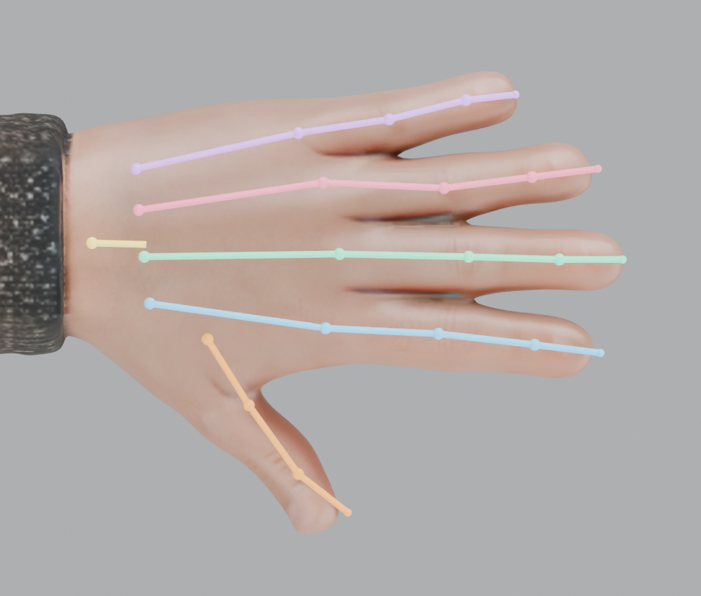
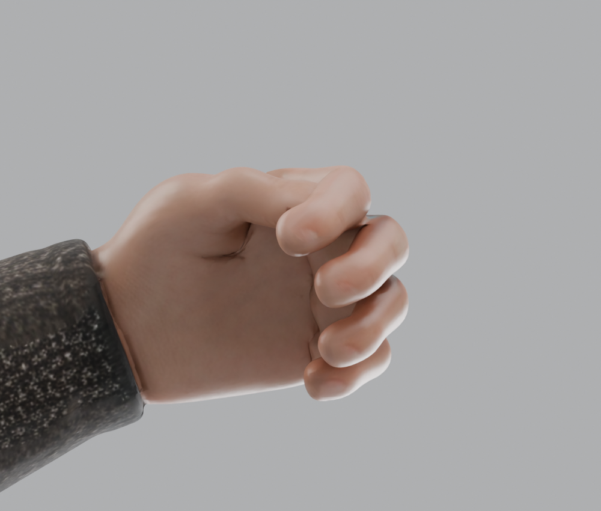

# 原始分块模型：人体骨骼绑定

日期：2026-10-26

快速查看图片与模型：[绑骨效果索引](../03_查看器/绑骨效果索引.md)。

输入为用户指定的 `assets/models/characters/parts/templar_tpose_unarmored_parts.glb`，16 个部件、没有原有骨骼。本次直接从此文件绑定，没有使用旧版 `rig` / `handfix` 的改形手部。

## 交付

- [Blender 可编辑骨骼及蒙皮](../../assets/models/characters/parts/templar_tpose_unarmored_parts_rig_anatomical.blend)
- [GLB 运行资产](../../assets/models/characters/parts/templar_tpose_unarmored_parts_rig_anatomical.glb)
- [绑定与资产保真校验](../../assets/renders/parts/anatomical/binding_validation.json)
- [GLB 重新导入及变形校验](../../assets/renders/parts/anatomical/roundtrip_validation.json)

共 60 根骨骼：22 根身体及根骨骼，每只手另有 19 根掌骨和指骨。原始 GLB 未覆盖。最终 GLB 的原始网格坐标、面索引、法线、UV、材质、贴图和部件变换保持原样。

## 手部结构

| 部位 | 每侧结构 | 骨骼命名 |
| --- | --- | --- |
| 腕部 / 掌根 | 手腕父级控制 | `hand.L/R` |
| 食指、中指、无名指、小指 | 每指 1 根掌骨 + 3 节指骨 | `index/middle/ring/pinky.metacarpal.L/R`、`.01/.02/.03.L/R` |
| 拇指 | 第一掌骨 + 近节指骨 + 远节指骨 | `thumb.metacarpal.L/R`、`thumb.01/.02.L/R` |

四指关节对应 MCP（掌指）、PIP（近端指间）、DIP（远端指间）。拇指对应 CMC（腕掌）、MCP、IP；拇指只有两节指骨，没有虚构第三节指骨。

关节沿原始手指实测中心线放置，两侧分别采样皮肤深度。四指局部 X 为屈曲轴，局部 Z 对应掌背方向。拇指指骨的屈伸轴相对掌面倾斜，第一掌骨可独立做对掌。掌骨独立控制，便于调整掌弓和握持。

在 Blender 中选骨架进入 Pose Mode：四指绕局部 **X 负向**屈曲，MCP 可绕局部 Z 张合；拇指先调整 `thumb.metacarpal` 的对掌，再调整 `.01` 和 `.02` 屈伸。左右手的局部屈曲方向一致，对掌的 Z 旋转方向互为镜像。骨骼集合 `Body`、`Hand L`、`Hand R` 用于筛选。

本次交付为 FK 绑定姿态，没有导出动作片段。Blender 文件保存精确的指尖骨尾位置；GLB 记录关节变换，部分编辑器会自行显示末端骨尾长度，继续编辑骨架时优先使用 `.blend`。

## 蒙皮及验证

手指使用按独立骨链投影的权重，沿实际皮肤邻接关系平滑，不跨越指缝传播。掌根与前臂使用统一的腕部权重过渡；分块重合位置共享权重。每个顶点最多 4 根骨骼影响，全部权重归一化，没有未绑定顶点。

GLB 保留每个部件的原始局部坐标，因此 16 个 skin 分别保存相应的绑定矩阵，全部引用同一套 60 关节骨架。

实测重新导入的静止表面最大误差约 0.0011 mm。单独屈曲任一侧食指 35°，食指指尖移动约 57.4 mm，其余四指指尖位移为 0。左右手均向掌心侧屈曲，拇指对掌朝掌内移动。6,228 组跨部件重合接缝在静止、屈指、转腕、屈肘、抬膝测试中的最大间隙小于 0.001 mm。

验收图中的握持姿势用于检查绑定；具体武器握把仍需按尺寸调整姿势。原始模型没有做关节拓扑重建，因此深度握拳的皮肤褶皱和体积仍受源网格限制。





## 复现

```sh
blender --background --threads 4 --python tools/rig_parts_anatomical.py
blender --background --threads 4 --factory-startup --python tools/check_anatomical_rig.py
```

`tools/patch_anatomical_glb.py` 在导出后转移骨架和蒙皮，按三角面角点对应关系处理 Blender 的法线拆分顶点，并保留原始 GLB 的几何与贴图数据。
