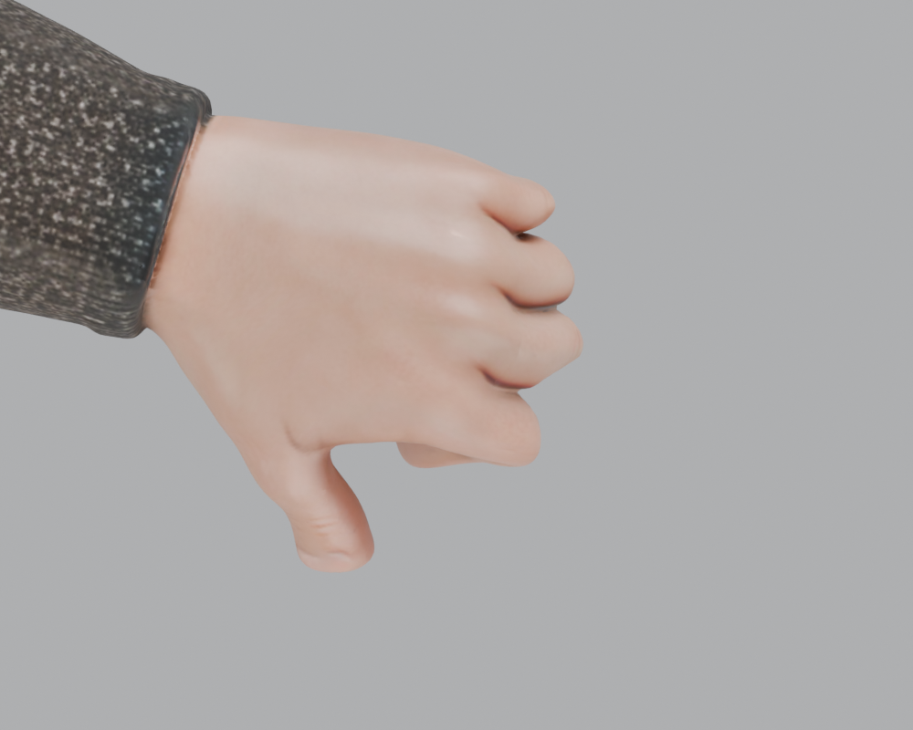
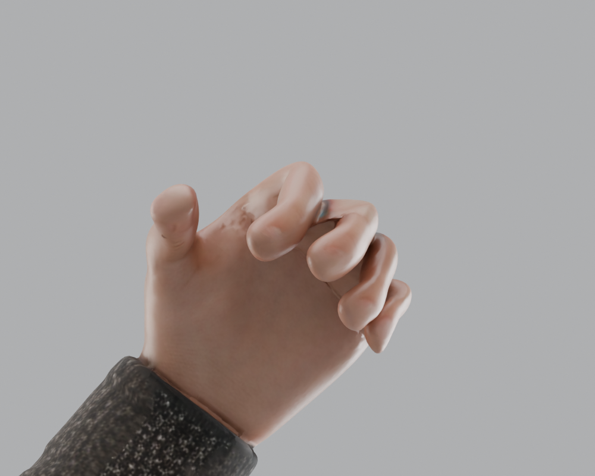

# 分块骑士模型：手部绑骨修订

日期：2026-10-26

## 交付文件

- [可编辑 Blender 文档](../../assets/models/characters/parts/templar_tpose_unarmored_parts_rig_handfix.blend)
- [修订后的 GLB 模型](../../assets/models/characters/parts/templar_tpose_unarmored_parts_rig_handfix.glb)
- [验收图片和数据](../../assets/renders/parts/handfix/)

以用户指定的 `templar_tpose_unarmored_parts_rig.glb` 为输入，修订结果另存为 `*_handfix`。原始文件未覆盖。

## 问题与调整

输入模型有 25 根骨骼，每侧只有一根 `hand.L/R`；五指没有独立骨骼，无法分别弯曲。手部原权重只分配给手骨和前臂骨，掌部容易随前臂混合变形。

1. 每侧补充五指各 3 根骨骼，共新增 30 根，总计 **55 根骨骼**。沿实际手指走向拟合关节，并分别读取左右手的几何深度。
2. 四指按掌指关节、近端指间关节、远端指间关节分节；拇指按掌腕、掌指、指间关节分节。保留原有手骨作为手腕及掌部的父级控制。
3. 重分配双手的掌部、指根、指节权重；通过相邻网格顶点平滑过渡，并合并 UV 接缝处重复坐标的权重计算，避免接缝两侧出现不同蒙皮。
4. 重算腕部附近约 3.6 cm 的前臂/手骨过渡，让袖口和掌根使用同一过渡函数。
5. 每顶点最多 4 根骨骼影响，权重归一化。五指间的分区使用掌平面距离，再沿皮肤表面平滑，减少相邻手指误牵拉。

最终 GLB 直接保留输入文件的顶点、三角面索引、法线、UV、材质与贴图，只更新新增骨骼、绑定矩阵及两手/两前臂的蒙皮属性。16 个部件继续共用一套骨架。未新增动作片段，文件保持绑定姿态。

## 骨骼使用

| 名称 | 用途 |
| --- | --- |
| `hand.L` / `hand.R` | 手腕转动，整只手跟随 |
| `thumb.01..03.L/R` | 拇指三段控制 |
| `index.01..03.L/R` | 食指三段控制 |
| `middle.01..03.L/R` | 中指三段控制 |
| `ring.01..03.L/R` | 无名指三段控制 |
| `pinky.01..03.L/R` | 小指三段控制 |

在 Blender 的 Pose Mode 中选择指骨，绕其局部 X 轴负向旋转进行屈指；左右手统一采用这一约定。掌背方向用于固定指骨滚转。建议从较小角度开始分别调整各节，持剑/握盾时再按把手形状调整拇指对掌和四指屈曲。

## 验证

- GLB 文件结构、16 个网格、55 个关节及蒙皮属性检查。
- 与输入文件逐项对照几何、法线、UV、面索引、贴图及未涉及身体部件的权重。
- 检查手和前臂的所有顶点均有权重，影响数不超过 4。
- 左右手分别渲染静止、屈指、转腕测试。
- 重新导入最终 GLB，检查绑定姿态误差，以及仅弯食指时其余四指指尖的位移。

具体验证结果见 [导出校验](../../assets/renders/parts/handfix/export_validation.json)、[权重和关节点](../../assets/renders/parts/handfix/validation.json)、[重新导入校验](../../assets/renders/parts/handfix/roundtrip_validation.json)。





屈指图用于检查蒙皮，不是持剑/握盾的最终动作。原始 AI 网格的指缝拓扑与皮肤厚度限制仍存在，极端握拳角度可能出现局部挤压；需要更紧的握持轮廓时，可继续制作针对武器的姿势和关节校正形态键。

## 复现

```sh
blender --background --threads 4 --python tools/fix_parts_hand_rig.py
```

脚本会输出新的 Blender 文档和 GLB，并通过 `tools/patch_parts_hand_glb.py` 把修订后的骨骼/权重写回原 GLB 的资产结构，避免普通 Blender 往返导出改变其它部位的法线。
