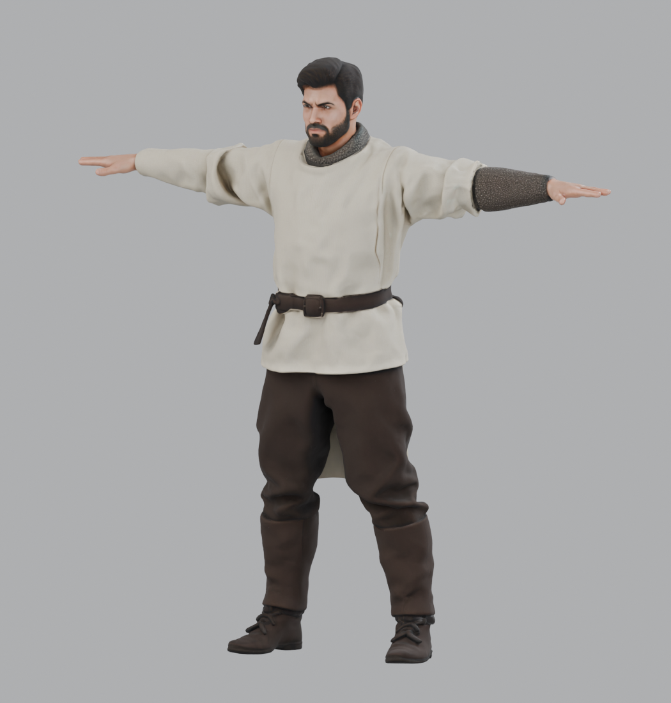
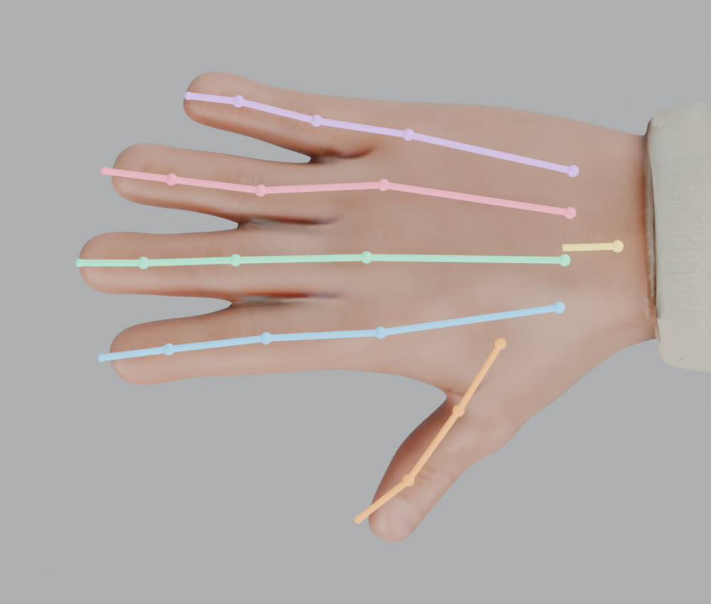
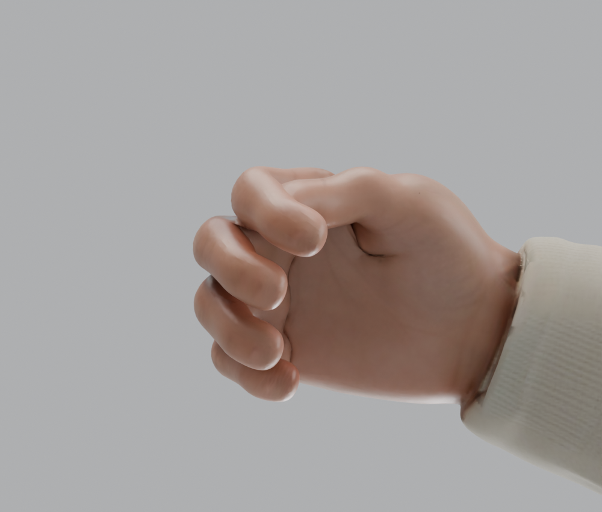
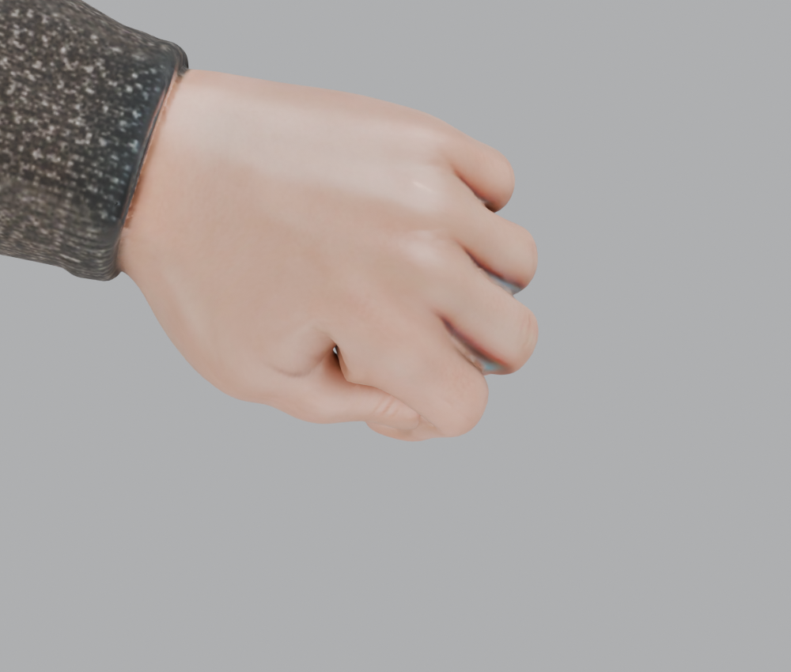
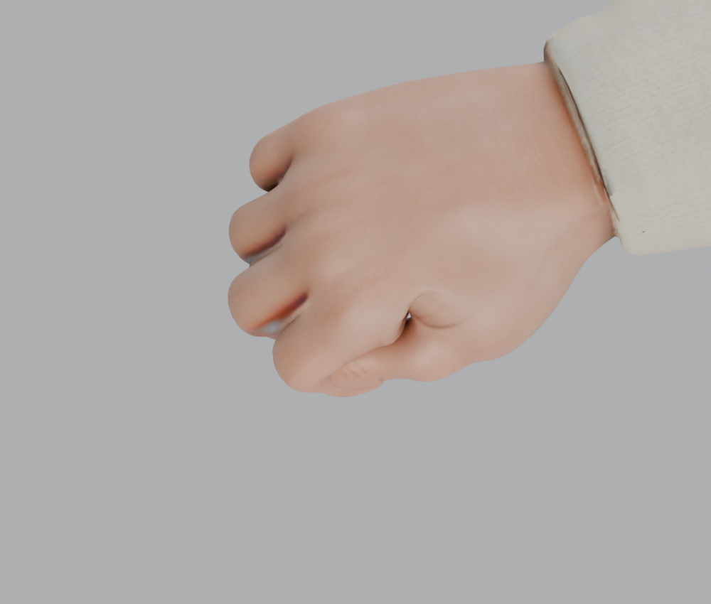
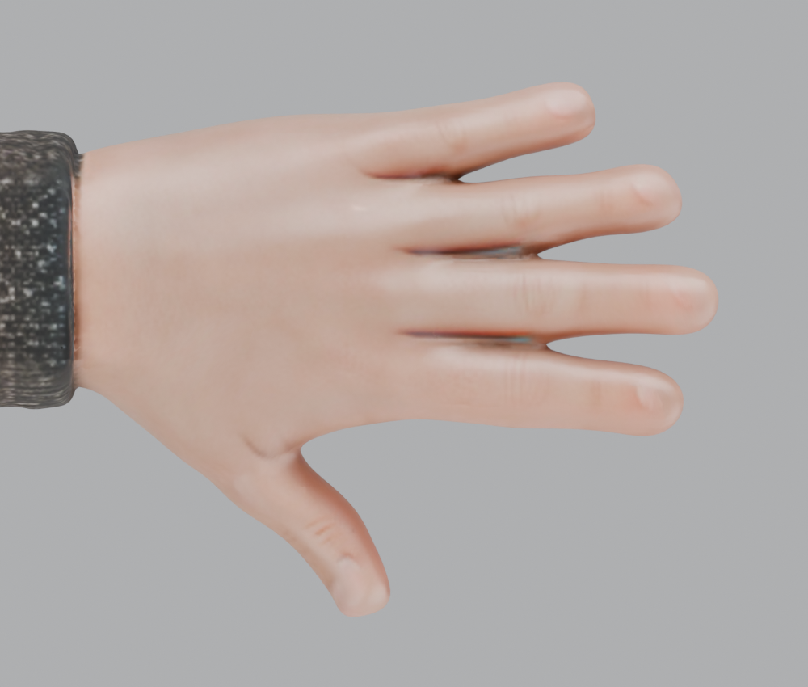
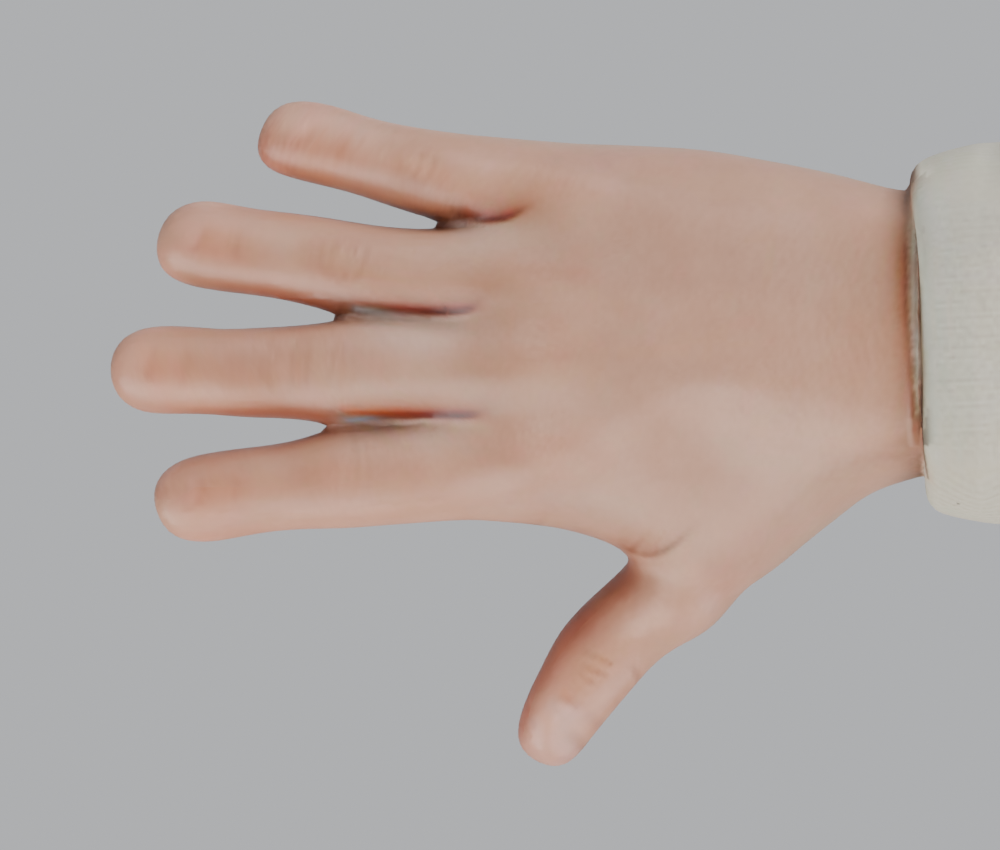

# 绑骨效果索引

更新：2026-10-26 · 当前版本：**人体结构绑定版 `rig_anatomical`**

**动态效果已制作：** [打开 8 套动画展示页](http://127.0.0.1:8765/site/anatomical.html) · [启动器](../../查看全部动画.command) · [动画文件与操作说明](动画展示说明.md)。下方继续保留静态绑定版的图片和文件入口。

这份索引集中展示这次绑定后的模型、双手骨架和屈指效果。图片可点击查看原尺寸；需要旋转模型、检查骨骼或摆姿势时，打开下面的 Blender 文件。

**快速跳转：** [模型文件](#模型文件) · [全身效果](#全身效果) · [手部骨骼](#手部骨骼) · [双手屈指效果](#双手屈指效果) · [静止手型](#静止手型) · [检查结果与说明](#检查结果与说明)

## 模型文件

| 入口 | 用途 |
| --- | --- |
| [打开 Blender 绑定源文件](../../assets/models/characters/parts/templar_tpose_unarmored_parts_rig_anatomical.blend) | **推荐。** 查看完整骨架、旋转模型、独立调整五指 |
| [打开 / 导入 GLB 模型](../../assets/models/characters/parts/templar_tpose_unarmored_parts_rig_anatomical.glb) | 在支持 glTF 的查看器或游戏引擎中查看蒙皮模型 |
| [绑定说明与骨骼操作](../02_资产管线/原始分块模型_人体骨骼绑定.md) | 骨骼命名、手部结构、蒙皮方法和复现命令 |

当前模型包含 **60 根骨骼、16 个蒙皮部件**。每只手有 5 根掌骨和 14 节指骨：四指各三节，拇指两节，并可独立对掌。

下面的屈指图片是绑定验收时摆出的测试姿势。交付模型保存为 T-pose，GLB 中尚无动画片段。

### 在 Blender 中查看

1. 打开上面的 `.blend` 文件，选中骨架，按 `Ctrl + Tab` 进入 **Pose Mode**。
2. 在骨骼集合中选择 `Hand L` 或 `Hand R`，查看对应手的掌骨和指骨；选中骨骼可在属性面板查看名称。
3. 旋转视角观察关节。四指绕局部 X 负向弯曲；先调整 `thumb.metacarpal` 的对掌，再调整拇指 `.01`、`.02` 两节。

## 全身效果

查看整体比例、绑定静止姿态及部件衔接。

## 手部骨骼

彩色线段展示掌骨与指骨的位置，圆点展示关节。每根四指链包含一段掌骨和三段指骨；拇指链包含一段掌骨和两段指骨。

| 左手骨架 | 右手骨架 |
| --- | --- |
|  |  |

| 颜色 | 手指 |
| --- | --- |
| 橙色 | 拇指 |
| 蓝色 | 食指 |
| 绿色 | 中指 |
| 粉色 | 无名指 |
| 紫色 | 小指 |

骨架示意采用 Blender 源文件的精确骨尾位置。GLB 只记录关节变换，部分软件会自行推测末端骨骼的显示长度。

## 双手屈指效果

重点观察指节是否向掌心弯曲、拇指能否对掌，以及指缝和掌根有没有明显拉扯。左右手使用相同的屈指测试角度。

### 掌心视角

| 左手 · 掌心 | 右手 · 掌心 |
| --- | --- |
|  |  |

### 手背视角

| 左手 · 手背 | 右手 · 手背 |
| --- | --- |
|  |  |

这是适度握持的验收姿势；持剑或握盾时，应按具体握把尺寸继续调整。深度握拳的皮肤褶皱和体积仍受原模型拓扑限制。

## 静止手型

与上面的屈指图对照，查看指长、手指间距、掌根和原始张开手型。

| 左手 · 静止 | 右手 · 静止 |
| --- | --- |
|  |  |

## 检查结果与说明

| 检查项 | 结果 |
| --- | --- |
| 骨骼与部件 | 60 根骨骼，16 个蒙皮部件 |
| 手部结构 | 每侧 5 掌骨 + 14 指骨，拇指可独立对掌 |
| 单指独立性 | 单独弯食指时，其余四指指尖位移为 0 |
| 左右手屈曲方向 | 均朝向掌心 |
| 蒙皮覆盖 | 所有顶点均有权重，每顶点最多 4 个骨骼影响 |
| 分块接缝 | 静止、屈指、转腕、屈肘和屈膝测试均通过 |
| 源资产保真 | 原始几何、法线、UV、材质和贴图保留 |

详细数据：[绑定与资产校验](../../assets/renders/parts/anatomical/binding_validation.json) · [GLB 回读与变形校验](../../assets/renders/parts/anatomical/roundtrip_validation.json)。

本索引对应文件名末尾为 **`_rig_anatomical`** 的版本。目录里的 `_rig` 和 `_rig_handfix` 是此前版本，查看本次结果请使用本页链接。

[返回项目首页](../../README.md) · [查看绑定制作说明](../02_资产管线/原始分块模型_人体骨骼绑定.md)
